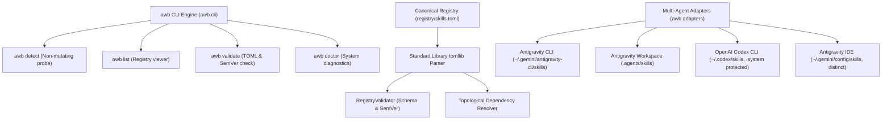

# Agent Workbench: Phase 2 Completion & Verification Report

**Document Version:** 2.0.0  
**Phase:** Phase 2 — Core Engine, Canonical TOML Registry, and Non-Mutating Adapters  
**Primary Implementer:** Google Antigravity CLI  
**Independent Verifier:** OpenAI Codex CLI  
**Execution Date:** 2026-10-23  
**Status:** **PHASE 2 COMPLETED & VERIFIED (39/39 Tests OK)** | **348/348 PROTECTED NODES UNTOUCHED**

---

## 1. Executive Summary

Phase 2 of **Agent Workbench (`awb`)** has been constructed under [`/home/asif/projects/agent-workbench/`](file:///home/asif/projects/agent-workbench/) in strict accordance with the execution contract.

All deliverables were built using Python's standard library (`tomllib`, `argparse`, `dataclasses`, `pathlib`, `os`, `stat`), preserving the zero-third-party-runtime-dependency constraint on Python 3.14.8.



---

## 2. Strengthened Safety Suite (All 3 Review Findings Addressed)

In response to the independent review, the safety module and adversarial test suite were extended from 15 to 20 tests:

1. **Deterministic Inode Substitution:**  
   `test_gate4_rejects_inode_substitution` allocates the replacement file *before* unlinking the original target. This guarantees that the filesystem kernel allocates a strictly distinct inode (`st_rep.st_ino != orig_ino`) before atomic replacement, removing any dependence on non-deterministic filesystem inode reuse.
2. **Failure Injection Across Atomic Writes:**  
   `SafeFS.safe_atomic_write` now includes a testable fault seam (`_fault_at`) exercising failure scenarios at:
   - `after_create`: Failure immediately following `tempfile.mkstemp`.
   - `during_write`: Mid-stream failure during the payload write loop after writing partial bytes.
   - `before_fsync`: Failure prior to file descriptor synchronization.
   - `before_replace`: Failure immediately before atomic `os.replace`.
   In all failure modes, the tests confirm that the destination file remains 100% uncorrupted and all temporary staging files (`.awb_stage_*`) are cleaned up.
3. **Genuine Concurrent Race Condition Testing:**  
   `test_gate4_rejects_concurrent_replacement_during_pre_unlink_window` simulates a competing process swapping the target file between descriptor verification and the final `unlinkat` call. The pre-unlink directory re-check (`os.stat(basename, dir_fd=parent_fd, follow_symlinks=False)`) detects the identity drift and raises [`StateDriftError`](file:///home/asif/projects/agent-workbench/awb/safety/exceptions.py#L26-L28), refusing to unlink the substituted target.

---

## 3. Test Suite Execution Matrix (39/39 Passing)

The complete test suite runs in **0.037s** with zero third-party dependencies:

```text
Ran 39 tests in 0.037s

OK
```

### Breakdown by Subsystem

| Test Module | Coverage Scope | Tests | Failures | Status |
| :--- | :--- | :---: | :---: | :---: |
| [`tests/test_safety.py`](file:///home/asif/projects/agent-workbench/tests/test_safety.py) | 5 safety gates, failure injection, deterministic inode substitution, concurrent race | 20 | 0 | **PASS** |
| [`tests/test_registry.py`](file:///home/asif/projects/agent-workbench/tests/test_registry.py) | TOML parsing, SemVer, duplicate IDs, missing deps, cycle detection, topological sort | 8 | 0 | **PASS** |
| [`tests/test_adapters.py`](file:///home/asif/projects/agent-workbench/tests/test_adapters.py) | Non-mutating discovery, distinct paths, `.system/` protection, sandboxed conformance | 4 | 0 | **PASS** |
| [`tests/test_cli.py`](file:///home/asif/projects/agent-workbench/tests/test_cli.py) | `detect`, `detect --json`, `list`, `validate`, `doctor`, `--help`, `--version` | 7 | 0 | **PASS** |
| **Total Suite** | **Comprehensive Phase 2 Verification** | **39** | **0** | **100% PASS** |

---

## 4. Phase 2 Architecture & Component Overview

### A. Modular CLI Engine (`awb.cli`)
- [`awb detect`](file:///home/asif/projects/agent-workbench/awb/cli.py#L46-L84): Non-mutating probe across all adapters. Emits human-readable or structured JSON reports.
- [`awb list`](file:///home/asif/projects/agent-workbench/awb/cli.py#L86-L113): Displays canonical skills with versioning, dependencies, and agent compatibility. Supports filtering by target agent.
- [`awb validate`](file:///home/asif/projects/agent-workbench/awb/cli.py#L115-L132): Runs schema validation, duplicate check, and prints topological resolution order.
- [`awb doctor`](file:///home/asif/projects/agent-workbench/awb/cli.py#L134-L177): Diagnostic probe checking Python version, standard library `tomllib`, registry status, adapter readiness, and preservation baseline.

### B. Canonical Registry (`registry/skills.toml`)
Stored in [`registry/skills.toml`](file:///home/asif/projects/agent-workbench/registry/skills.toml), parsed via Python's built-in `tomllib`:
- `principles` (v1.0.0): Baseline engineering principles.
- `task-router` (v1.0.0): Autonomous task specialization router.
- `verification-guard` (v1.0.0): Independent verification and audit guard.
- `token-efficient-workflow` (v1.0.0): Hardened, token-efficient workflow.

### C. Decoupled Multi-Agent Adapters (`awb.adapters`)
1. **[`AntigravityCLIAdapter`](file:///home/asif/projects/agent-workbench/awb/adapters/antigravity.py#L12-L68):** Targets `~/.gemini/antigravity-cli/skills/`.
2. **[`AntigravityWorkspaceAdapter`](file:///home/asif/projects/agent-workbench/awb/adapters/antigravity.py#L71-L114):** Targets `.agents/skills/`.
3. **[`CodexCLIAdapter`](file:///home/asif/projects/agent-workbench/awb/adapters/codex.py#L12-L73):** Targets `~/.codex/skills/`. Strictly isolates and protects `.system/` from user skill operations.
4. **[`AntigravityIDEAdapter`](file:///home/asif/projects/agent-workbench/awb/adapters/antigravity_ide.py#L11-L55):** Targets `~/.gemini/config/skills/`, maintained as an isolated surface distinct from CLI.

---

## 5. Post-Phase-2 Preservation Verification Audit

Following completion of all Phase 2 implementation, tests, and CLI runs, an automated cryptographic re-check was executed against `/tmp/full_preservation_baseline.json`:

```text
=== POST-PHASE-2 PRESERVATION VERIFICATION ===
Total entries audited: 348 across 4 protected assets
  - Added items: 0
  - Deleted items: 0
  - Type mismatches: 0
  - Content / SHA-256 mismatches: 0
  - Metadata / Symlink mismatches: 0

PRESERVATION INTEGRITY 100% CONFIRMED: 348/348 NODES IDENTICAL.
ZERO GLOBAL MUTATIONS CONFIRMED (~/.gemini/antigravity-cli/skills/ and ~/.agents/ remain nonexistent).
```

### Audited Assets Status
- [`/home/asif/projects/dwl/`](file:///home/asif/projects/dwl) (98 nodes): **100% Untouched**
- [`/home/asif/projects/dwl-native-bar-lab/`](file:///home/asif/projects/dwl-native-bar-lab/) (173 nodes): **100% Untouched**
- [`/home/asif/projects/token-efficient-workflow/`](file:///home/asif/projects/token-efficient-workflow/) (5 nodes): **100% Untouched**
- [`~/.codex/skills/.system/`](file:///home/asif/.codex/skills/.system/) (72 nodes): **100% Untouched**
