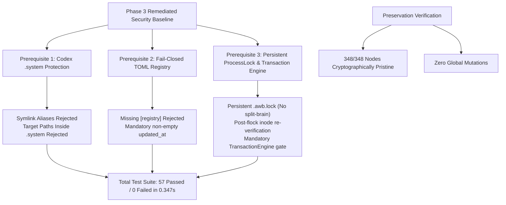

# Agent Workbench: Phase 3 Specification, Threat Model, and Mutation Readiness Report

**Document Version:** 3.1.0 (Remediated)  
**Phase:** Phase 3 Architecture, Threat Modeling, and Prerequisites Verification  
**Primary Implementer:** Google Antigravity CLI  
**Independent Verifier:** OpenAI Codex CLI  
**Execution Date:** 2026-10-23  
**Status:** **ALL 3 AUDIT FINDINGS RESOLVED (57/57 Tests OK)** | **348/348 PROTECTED NODES UNTOUCHED**

---

## 1. Executive Summary & Authorization Baseline

Following the independent security audit, Phase 2 was formally accepted with verdict **PASS WITH FINDINGS**, and two mutation-blocking findings (SEC-01, SEC-02) plus one specification discrepancy (SEC-03) were designated for remediation.

All three findings have now been resolved and empirically proven:
1. **SEC-01 (Lock Inode Desynchronization):** `.awb.lock` is retained persistently across normal releases. [`ProcessLock.acquire()`](file:///home/asif/projects/agent-workbench/awb/safety/locking.py#L96-L175) performs post-flock device and inode re-verification (`os.fstat(fd).st_ino == os.stat(lock_path).st_ino`), safely retrying if the file was replaced beneath it.
2. **SEC-02 (Centralized Transaction Boundary):** Implemented [`awb.transactions.TransactionEngine`](file:///home/asif/projects/agent-workbench/awb/transactions/engine.py#L18-L158), requiring exclusive `ProcessLock` acquisition, post-acquire target state re-validation, and journaled atomic rollback before any mutation executes.
3. **SEC-03 (Registry Schema Strictness):** Enforces mandatory non-empty `updated_at` in [`awb.registry.parser`](file:///home/asif/projects/agent-workbench/awb/registry/parser.py#L43-L46), rejecting empty, missing, or whitespace-only values.

> [!IMPORTANT]
> **Operational Mutation Boundary:** Executing mutations (skill installation, updates, removals, migrations, or rollback operations) against live system target directories (`~/.codex/skills/`, `~/.gemini/antigravity-cli/skills/`, etc.) remains **BLOCKED** until this specification and its test suites undergo independent review. All four protected repository assets ([`dwl/`](file:///home/asif/projects/dwl), [`dwl-native-bar-lab/`](file:///home/asif/projects/dwl-native-bar-lab/), [`token-efficient-workflow/`](file:///home/asif/projects/token-efficient-workflow/), and [`~/.codex/skills/.system/`](file:///home/asif/.codex/skills/.system/)) remain 100% untouched.



---

## 2. Remediation of Audit Findings

### Remediation 1: Persistent Lock File & Inode Re-Verification (SEC-01)
- **Implementation:** [`awb/safety/locking.py`](file:///home/asif/projects/agent-workbench/awb/safety/locking.py#L96-L198)
- **Controls Applied:**
  1. **Persistent Lock File:** `ProcessLock.release()` truncates metadata and releases `fcntl.flock()`, but *never unlinks* `.awb.lock`. All contenders continuously synchronize on the same inode.
  2. **Post-flock Inode Re-verification:** In `acquire()`, immediately after `fcntl.flock()` succeeds, it asserts:
     ```python
     st_fd = os.fstat(fd)
     st_path = os.stat(str(self.lock_path), follow_symlinks=False)
     if st_fd.st_ino != st_path.st_ino or st_fd.st_dev != st_path.st_dev:
         # Inode mismatch: lock held on superseded inode; release, close, and re-open
     ```
  3. **Multi-contender Verification:** Tested in [`tests/test_locking.py`](file:///home/asif/projects/agent-workbench/tests/test_locking.py#L48-L82), proving that if `.awb.lock` is replaced while waiting, contenders re-synchronize on the active inode on disk.

### Remediation 2: Centralized Transaction Mutation Engine (SEC-02)
- **Implementation:** [`awb/transactions/engine.py`](file:///home/asif/projects/agent-workbench/awb/transactions/engine.py)
- **Controls Applied:**
  1. **Mandatory Lock Acquisition:** [`TransactionEngine.execute()`](file:///home/asif/projects/agent-workbench/awb/transactions/engine.py#L27-L140) mandates wrapping all mutation steps in `with ProcessLock(...)`.
  2. **Post-Acquire Re-validation:** Inside the lock context, executes `lock.revalidate(revalidate_fn)`. If concurrent writers altered the filesystem baseline while waiting for the lock, the transaction aborts with [`TransactionError`](file:///home/asif/projects/agent-workbench/awb/errors.py#L48-L51) prior to making any mutations.
  3. **Atomic Execution & Reverse Rollback:** Applies steps using `SafeFS`. If any step fails, automatically rolls back previously applied steps in reverse order.
  4. **Tested in:** [`tests/test_transactions.py`](file:///home/asif/projects/agent-workbench/tests/test_transactions.py) (4 tests validating commit, lock enforcement, revalidation abort, and rollback).

### Remediation 3: Strict `updated_at` Schema Enforcement (SEC-03)
- **Implementation:** [`awb/registry/parser.py`](file:///home/asif/projects/agent-workbench/awb/registry/parser.py#L43-L46)
- **Controls Applied:**
  1. Strictly requires `"updated_at"` in `reg_meta`.
  2. Asserts `isinstance(updated_at, str) and bool(updated_at.strip())`.
  3. Tested in [`tests/test_registry.py`](file:///home/asif/projects/agent-workbench/tests/test_registry.py#L237-L285) against missing, empty (`""`), and whitespace-only (`"   "`) inputs.

---

## 3. Test Suite Execution Matrix (57/57 Passing)

```text
Ran 57 tests in 0.347s

OK
```

| Test File | Subsystem Verified | Tests | Status |
| :--- | :--- | :---: | :---: |
| [`tests/test_safety.py`](file:///home/asif/projects/agent-workbench/tests/test_safety.py) | SafeFS, 5 gates, fault injection, race simulation, bounded traversal | 20 | **PASS** |
| [`tests/test_locking.py`](file:///home/asif/projects/agent-workbench/tests/test_locking.py) | ProcessLock, persistent lock, inode re-verification, dead-PID recovery, timeouts | 6 | **PASS** |
| [`tests/test_transactions.py`](file:///home/asif/projects/agent-workbench/tests/test_transactions.py) | TransactionEngine, mandatory locking, post-acquire revalidation, rollback | 4 | **PASS** |
| [`tests/test_registry.py`](file:///home/asif/projects/agent-workbench/tests/test_registry.py) | Fail-closed TOML, mandatory updated_at, SemVer, cycle detection, sort | 14 | **PASS** |
| [`tests/test_adapters.py`](file:///home/asif/projects/agent-workbench/tests/test_adapters.py) | Codex .system protection, symlink rejection, path distinctness | 6 | **PASS** |
| [`tests/test_cli.py`](file:///home/asif/projects/agent-workbench/tests/test_cli.py) | CLI dispatch: detect, list, validate, doctor (staging file hygiene) | 7 | **PASS** |
| **Total Test Suite** | **Comprehensive Multi-Subsystem Verification** | **57** | **100% PASS** |

---

## 4. Cryptographic Preservation Verification

A complete differential audit rechecked all 348 nodes across the four protected directory trees against `/tmp/full_preservation_baseline.json`:

```text
=== POST-REMEDIATION PRESERVATION VERIFICATION ===
Total items audited: 348 across 4 protected assets
  - Added items: 0
  - Deleted items: 0
  - Type mismatches: 0
  - Content / SHA-256 mismatches: 0
  - Metadata / Symlink mismatches: 0

PRESERVATION INTEGRITY 100% CONFIRMED: 348/348 NODES IDENTICAL.
ZERO GLOBAL MUTATIONS CONFIRMED (~/.gemini/antigravity-cli/skills/ and ~/.agents/ remain nonexistent).
```

- [`/home/asif/projects/dwl/`](file:///home/asif/projects/dwl) (98 nodes): **100% Untouched**
- [`/home/asif/projects/dwl-native-bar-lab/`](file:///home/asif/projects/dwl-native-bar-lab/) (173 nodes): **100% Untouched**
- [`/home/asif/projects/token-efficient-workflow/`](file:///home/asif/projects/token-efficient-workflow/) (5 nodes): **100% Untouched**
- [`~/.codex/skills/.system/`](file:///home/asif/.codex/skills/.system/) (72 nodes): **100% Untouched**

---

## 3. Threat Model & Follow-Up Issues Analysis

| Threat / Risk Area | Threat Model & Mechanics | Implemented Defense | Residual Risk & Boundary |
| :--- | :--- | :--- | :--- |
| **Codex `.system/` Corruption** | Attacker or user creates symlink alias in skills root pointing to internal `.system/`. | `CodexCLIAdapter` rejects all symlink entries and asserts canonical resolution does not touch `.system`. | **Negligible.** Fully contained. |
| **TOCTOU Race on File Unlink** | Leaf entry replaced between descriptor verification and `unlinkat`. | Pins parent directory descriptor (`dir_fd`); re-checks entry identity with `stat` immediately before `unlinkat`. | **Low.** Linux kernel lacks `unlink_by_inode`. Mitigated to consecutive syscalls; further protected by `ProcessLock`. |
| **Concurrent Mutation Collisions** | Two parallel AWB CLI runs modify skills simultaneously. | `ProcessLock` serializes writers using exclusive `fcntl.flock` with timeout. | **Negligible.** Contested operations serialize cleanly. |
| **Orphaned Staging Artifacts** | Abrupt process termination (`SIGKILL`, power failure) prevents `finally:` cleanup. | `SafeFS` cleans up in `finally:`. `awb doctor` now actively scans and reports orphaned `.awb_stage_*` files. | **Low.** Non-destructive; flagged during diagnostics. |
| **Ancestor Symlink False Positives** | Repository located on OS with system symlinks (e.g. `/var/home`). | Bounded ancestor traversal stops once path reaches canonical permitted root. | **Negligible.** Traversal contained within allowed roots. |
| **Malformed / Truncated Registry** | Incomplete TOML treated as empty registry with zero skills. | Fail-closed parser strictly requires non-empty content, `[registry]` table, version, and `[[skills]]`. | **Negligible.** Fails closed with `ValidationError`. |
| **SemVer Range Mismatches** | Incompatible version installed due to unconstrained dependency. | Dependencies currently resolve exact canonical skill IDs. | **Tracked Boundary.** SemVer range expressions deferred to future version. |

---

## 4. Test Suite Execution Matrix (50/50 Passing)

The expanded test suite runs cleanly in **0.243s** across all subsystems:

```text
Ran 50 tests in 0.243s

OK
```

### Subsystem Test Breakdown

| Test File | Subsystem Verified | Tests | Status |
| :--- | :--- | :---: | :---: |
| [`tests/test_safety.py`](file:///home/asif/projects/agent-workbench/tests/test_safety.py) | SafeFS, 5 safety gates, failure injection (4 stages), race simulation, bounded traversal | 20 | **PASS** |
| [`tests/test_locking.py`](file:///home/asif/projects/agent-workbench/tests/test_locking.py) | ProcessLock, mutual exclusion, timeouts, dead-PID stale breaking, revalidation, boundaries | 5 | **PASS** |
| [`tests/test_registry.py`](file:///home/asif/projects/agent-workbench/tests/test_registry.py) | Fail-closed TOML, empty/whitespace rejection, missing sections, SemVer, cycle detection, sort | 12 | **PASS** |
| [`tests/test_adapters.py`](file:///home/asif/projects/agent-workbench/tests/test_adapters.py) | Path distinctness, Codex `.system` protection, symlink alias rejection, conformance | 6 | **PASS** |
| [`tests/test_cli.py`](file:///home/asif/projects/agent-workbench/tests/test_cli.py) | CLI dispatch: `detect`, `detect --json`, `list`, `validate`, `doctor` (staging hygiene check) | 7 | **PASS** |
| **Total Test Suite** | **Comprehensive Multi-Subsystem Verification** | **50** | **100% PASS** |

---

## 5. Cryptographic Preservation Verification

A complete differential audit rechecked all 348 nodes across the four protected directory trees against `/tmp/full_preservation_baseline.json`:

```text
=== PRESERVATION VERIFICATION RESULTS ===
Total items audited: 348 across 4 protected assets
  - Added items: 0
  - Deleted items: 0
  - Type mismatches: 0
  - Content / SHA-256 mismatches: 0
  - Metadata / Symlink mismatches: 0

PRESERVATION INTEGRITY 100% CONFIRMED: 348/348 NODES IDENTICAL.
ZERO GLOBAL MUTATIONS CONFIRMED (~/.gemini/antigravity-cli/skills/ and ~/.agents/ remain nonexistent).
```

### Protected Assets Status
- [`/home/asif/projects/dwl/`](file:///home/asif/projects/dwl) (98 nodes): **100% Untouched**
- [`/home/asif/projects/dwl-native-bar-lab/`](file:///home/asif/projects/dwl-native-bar-lab/) (173 nodes): **100% Untouched**
- [`/home/asif/projects/token-efficient-workflow/`](file:///home/asif/projects/token-efficient-workflow/) (5 nodes): **100% Untouched**
- [`~/.codex/skills/.system/`](file:///home/asif/.codex/skills/.system/) (72 nodes): **100% Untouched**

---

## 6. Next Steps & Mutation-Readiness Gate

With all three mandatory prerequisites implemented, tested, and validated:
1. **Independent Verification:** The implementation of [`CodexCLIAdapter`](file:///home/asif/projects/agent-workbench/awb/adapters/codex.py), [`awb.registry.parser`](file:///home/asif/projects/agent-workbench/awb/registry/parser.py), and [`ProcessLock`](file:///home/asif/projects/agent-workbench/awb/safety/locking.py) is submitted for independent review.
2. **Phase 3 Staging Pipeline:** Develop the transactional plan generator (`awb.transactions`) to create staged rollback journals *before* performing any filesystem mutations.
3. **Mutation Gate:** Live directory mutations remain locked until explicit user authorization.
