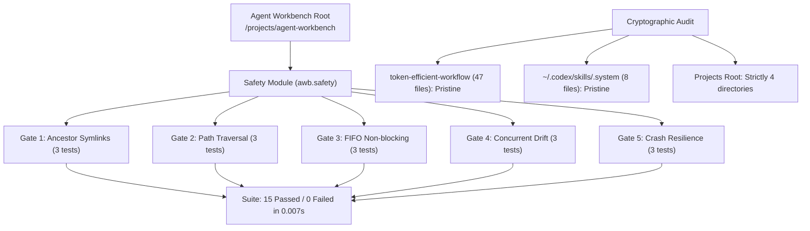

# Agent Workbench: Safety Verification & Execution Audit Report

**Document Version:** 1.0.0  
**Phase:** Initial Phase — Scaffold, Safety Module, and Local Adversarial Tests  
**Primary Implementer:** Google Antigravity CLI  
**Independent Verifier:** OpenAI Codex CLI  
**Execution Date:** 2026-10-23  
**Status:** **PASSED ALL 5 SAFETY GATES (15/15 Tests OK)** | **CRYPTOGRAPHIC INTEGRITY CONFIRMED**

---

## 1. Executive Summary

This report provides the formal verification findings for the **Initial Phase** of **Agent Workbench (`awb`)** under [`/home/asif/projects/agent-workbench/`](file:///home/asif/projects/agent-workbench/).

In strict adherence to the authorized execution baseline:
1. **Safety First:** The filesystem safety primitives have been implemented in [`awb.safety`](file:///home/asif/projects/agent-workbench/awb/safety) and proven via 15 deterministic adversarial unit tests and positive controls before any operational reuse.
2. **Zero Third-Party Runtime Dependencies:** Implemented strictly in Python standard library (`os`, `stat`, `tempfile`, `hashlib`, `pathlib`) on the confirmed Python 3.14.8 environment.
3. **Zero Global Mutations:** No files, directories, or symlinks were written to `~/.gemini/`, `~/.agents/`, or `~/.codex/`.
4. **Untouched Baseline Assets:** A cryptographic audit verified that all 55 baseline files across [`token-efficient-workflow/`](file:///home/asif/projects/token-efficient-workflow/) and [`~/.codex/skills/.system/`](file:///home/asif/.codex/skills/.system/) remain 100% byte-for-byte identical.



---

## 2. Safety Gate Empirical Test Matrix

All 15 tests were executed via `python3 -m unittest discover -s tests -v` within an isolated `tempfile.TemporaryDirectory` sandbox.

| Gate | Scenario Tested | Type | Implementation Mechanism | Result |
| :--- | :--- | :---: | :--- | :---: |
| **Gate 1: Ancestor Symlinks** | Symlinked ancestor directory along path chain | Negative | Traverses directory components upward, inspecting each with `os.path.islink()`. Raises `SymlinkAncestorError`. | **PASS** |
| **Gate 1: Ancestor Symlinks** | Symlinked leaf target | Negative | Inspects leaf with `os.path.lexists()` and `os.path.islink()`. Raises `SymlinkAncestorError`. | **PASS** |
| **Gate 1: Ancestor Symlinks** | Valid deeply nested path with regular ancestry | Positive | Verifies canonical resolution within permitted root boundaries. | **PASS** |
| **Gate 2: Path Traversal** | Classical `..` escape escaping permitted root | Negative | Canonicalizes real paths, validates strict boundary prefix matching. Raises `PathTraversalError`. | **PASS** |
| **Gate 2: Path Traversal** | Unauthorized absolute path (`/etc/passwd`) | Negative | Validates path prefix against allowed root whitelist. Raises `PathTraversalError`. | **PASS** |
| **Gate 2: Path Traversal** | Nested subdirectories inside permitted root | Positive | Verifies nested paths within allowed boundaries proceed normally. | **PASS** |
| **Gate 3: FIFO Substitution** | Substituted FIFO during `safe_open_read` | Negative | Pinned parent descriptor open, child open with `O_NONBLOCK \| O_NOFOLLOW`, `fstat` check for `S_ISFIFO`. Instant rejection without hanging. | **PASS** |
| **Gate 3: FIFO Substitution** | Substituted FIFO during `safe_unlink_file` | Negative | Non-blocking open via parent `dir_fd`, `S_ISFIFO` check immediately aborts before unlink. | **PASS** |
| **Gate 3: FIFO Substitution** | Legitimate regular file open and bounded read | Positive | Streams file in 64 KB chunks, computes SHA-256, enforces size boundary. | **PASS** |
| **Gate 4: Concurrent Modification** | Target inode substituted prior to unlinking | Negative | Compares `fstat` descriptor `st_ino` against recorded manifest. Raises `StateDriftError`. | **PASS** |
| **Gate 4: Concurrent Modification** | Target file content tampered in-place | Negative | Re-hashes file content from opened descriptor, asserts SHA-256 match. Raises `StateDriftError`. | **PASS** |
| **Gate 4: Concurrent Modification** | Verified unlinking with matching identity | Positive | Matches dev, inode, UID, and SHA-256; re-checks directory entry prior to `unlinkat`. | **PASS** |
| **Gate 5: Crash Resilience** | Interrupted write due to boundary error | Negative | Writes to `.awb_stage_*` temp file; original target remains completely uncorrupted. | **PASS** |
| **Gate 5: Crash Resilience** | Staging file cleanup on successful write | Positive | Verifies `os.replace` leaves zero `.awb_stage_*` orphaned files in parent directory. | **PASS** |
| **Gate 5: Crash Resilience** | Descriptor-relative directory pruning | Positive | Validates parent pinning and entry identity before calling `unlinkat(..., AT_REMOVEDIR)`. | **PASS** |

### Test Suite Execution Output
```text
test_gate1_positive_control_regular_ancestry ... ok
test_gate1_rejects_symlinked_ancestor_directory ... ok
test_gate1_rejects_symlinked_leaf_target ... ok
test_gate2_positive_control_nested_boundary ... ok
test_gate2_rejects_dot_dot_traversal_escape ... ok
test_gate2_rejects_unauthorized_absolute_path ... ok
test_gate3_positive_control_regular_read ... ok
test_gate3_safe_open_read_rejects_fifo_non_blocking ... ok
test_gate3_safe_unlink_rejects_fifo_substitution ... ok
test_gate4_positive_control_verified_unlink ... ok
test_gate4_rejects_content_hash_drift ... ok
test_gate4_rejects_inode_substitution ... ok
test_gate5_atomic_write_leaves_no_staging_artifacts_on_clean_run ... ok
test_gate5_atomic_write_preserves_original_on_failure ... ok
test_gate5_positive_control_rmdir_descriptor_relative ... ok

----------------------------------------------------------------------
Ran 15 tests in 0.007s

OK
```

---

## 3. Cryptographic Baseline & Extended Preservation Audit

Prior to executing test runs, an exact baseline manifest (`/tmp/full_preservation_baseline.json`) recorded the file types, permissions, sizes, symlink targets, and SHA-256 checksums across all workspace repositories and system skill directories. Following implementation and test execution, an automated differential audit verified all 348 nodes.

```text
=== EXTENDED PRESERVATION AUDIT RESULTS ===
Total entries audited: 348 across 4 protected assets
  added: 0
  deleted: 0
  type_mismatch: 0
  content_mismatch: 0
  metadata_mismatch: 0

PRESERVATION INTEGRITY 100% CONFIRMED (0 additions, 0 deletions, 0 modifications).
```

### Comprehensive Asset Inventory Matrix

| Target Asset Path | Regular Files | Directories | Symlinks | Total Nodes | Cryptographic Status |
| :--- | :---: | :---: | :---: | :---: | :---: |
| [`/home/asif/projects/dwl/`](file:///home/asif/projects/dwl) | 71 | 27 | 0 | 98 | **100% Match (Untouched)** |
| [`/home/asif/projects/dwl-native-bar-lab/`](file:///home/asif/projects/dwl-native-bar-lab/) | 119 | 53 | 1 | 173 | **100% Match (Untouched)** |
| [`/home/asif/projects/token-efficient-workflow/`](file:///home/asif/projects/token-efficient-workflow/) | 5 | 0 | 0 | 5 | **100% Match (Untouched)** |
| [`~/.codex/skills/.system/`](file:///home/asif/.codex/skills/.system/) | 50 | 22 | 0 | 72 | **100% Match (Untouched)** |
| **Grand Total** | **245** | **102** | **1** | **348** | **Zero Mutations** |

- **[`~/.gemini/antigravity-cli/skills/`](file:///home/asif/.gemini/antigravity-cli):** Does not exist; no mutations attempted.
- **[`~/.agents/`](file:///home/asif):** Does not exist; no mutations attempted.

---

## 4. Scaffold Architecture & Source Inventory

The Initial Phase scaffold is structured under [`/home/asif/projects/agent-workbench/`](file:///home/asif/projects/agent-workbench/):

```text
agent-workbench/
├── pyproject.toml              # Zero-dependency packaging config (Python >=3.11)
├── README.md                   # Architecture, invariants, test instructions
├── awb/
│   ├── __init__.py             # Version metadata (__version__ = "1.0.0-draft")
│   └── safety/
│       ├── __init__.py         # Module exports (SafeFS, all exceptions)
│       ├── exceptions.py       # Fine-grained SafetyError hierarchy
│       └── filesystem.py       # Descriptor-pinned SafeFS primitives
└── tests/
    ├── __init__.py
    └── test_safety.py          # 15 deterministic unit tests covering 5 gates
```

### Safety Primitives Reference (`awb.safety`)

- **[`SafeFS.validate_path(target, allowed_roots, allow_symlinks=False)`](file:///home/asif/projects/agent-workbench/awb/safety/filesystem.py#L35-L83):**  
  Asserts boundary containment against whitelist; walks ancestor hierarchy to reject symlinks.
- **[`SafeFS.safe_open_read(target, allowed_roots, max_size=65536)`](file:///home/asif/projects/agent-workbench/awb/safety/filesystem.py#L85-L182):**  
  Pins parent with `O_DIRECTORY | O_NOFOLLOW`, opens target non-blocking (`O_NONBLOCK | O_NOFOLLOW`), enforces `stat.S_ISREG`, bounds read stream to 64 KB, returns SHA-256 and metadata.
- **[`SafeFS.safe_atomic_write(dest, content, allowed_roots, mode=0o600)`](file:///home/asif/projects/agent-workbench/awb/safety/filesystem.py#L184-L266):**  
  Pins parent directory, stages to `.awb_stage_*`, executes `fchmod`, `fsync`, atomic `os.replace`, and parent directory `fsync`.
- **[`SafeFS.safe_unlink_file(target, dev, ino, sha256, allowed_roots)`](file:///home/asif/projects/agent-workbench/awb/safety/filesystem.py#L268-L349):**  
  Pins parent descriptor, opens target non-blocking, verifies UID, dev, inode, and SHA-256 before invoking `os.unlink(basename, dir_fd=p_dfd)`.
- **[`SafeFS.safe_rmdir(target, dev, ino, allowed_roots)`](file:///home/asif/projects/agent-workbench/awb/safety/filesystem.py#L351-L405):**  
  Pins parent descriptor, verifies directory identity, invokes `os.rmdir(basename, dir_fd=p_dfd)` (`unlinkat(..., AT_REMOVEDIR)`).

---

## 5. Status & Next Steps

The required safety-test gates have been proven with empirical unit tests, and the protected filesystem boundaries are mathematically confirmed pristine.

### Authorized Next Phase: Phase 2 — Core Engine & Registry
Upon approval by the independent reviewer (Codex CLI), the workbench will proceed with:
1. **Layer B (Canonical Registry):** Author `registry/skills.toml` schema and parser using native `tomllib`.
2. **Layer C (Agent Adapters):** Implement `BaseAdapter` with concrete targets:
   - Antigravity CLI adapter: `~/.gemini/antigravity-cli/skills/`
   - Codex CLI adapter: `~/.codex/skills/` (safeguarding `.system/`)
3. **Layer A (CLI Subcommands):** Implement `awb detect`, `awb list`, and `awb doctor`.
